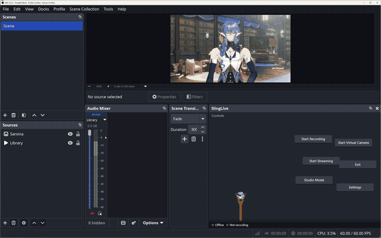

# Sarxina OBS Plugins

Silly (and some useful) OBS plugins for VTubers and streamers. Grab the **Sarxina OBS Plugin Manager**, then install whichever plugins you want right from it.

## Sarxina OBS Plugin Manager

One dock where you pick your plugins and change their settings behind each one's gear. It also hooks them up to VTube Studio and to Twitch: hit **Connect** next to **Twitch** in the dock and enter the code it shows at twitch.tv/activate, once. That one connection is all of Twitch for every plugin: your chat's commands, channel point redeems, and the rewards in their settings. Not to be confused with OBS's own Plugin Manager under Tools; this one is just for Sarxina plugins.

**Install it:** close OBS, download the manager's zip from [the latest release](../../releases/latest) and extract it into your OBS folder (usually `C:\Program Files\obs-studio`). Open OBS, tick **Sarxina OBS Plugin Manager** under **Docks**, hit **Install** on the plugins you want and restart OBS. **Uninstall** takes one back out.

Needs OBS Studio 32.2 or newer on Windows.

## The plugins

| Plugin | What it is | What it does |
|---|---|---|
| **SlingLive** | Dock | Slingshot your head at your Record and Go Live buttons. Good luck hitting the right one. |
| **PlinkoLive** | Dock | Drop your head down a Plinko board to decide whether you Record, Go Live or Exit. |
| **PlinkoToggle** | Source | A Plinko board on stream that chat plays: a chat command (or a channel point redeem) drops a ball, and whichever VTube Studio toggle it lands on gets switched on your model. The board grows with your toggles. |
| **JobApplication** | VTube Studio item | A big job application pinned to your model's chest that moves like paper: it lags behind you, swings back, curls and flaps, run by VTube Studio's own Live2D physics. Chat fills it in: each channel point redeem adds a line of work experience with the viewer's name. A hotkey brings it up and takes it away. |
| **Sarxina Parametric EQ** | Audio filter | A drag-the-curve EQ laid out like Adobe Audition's Parametric Equalizer. |
| **Sarxina Noise Gate** | Audio filter | Cuts the room noise under your voice without chopping the ends of your words. |
| **Sarxina Hard Limiter** | Audio filter | A look-ahead limiter like Audition's Hard Limiter; nothing ever goes over the ceiling. |

**Where they show up after installing:**
- **Docks:** the OBS menu **Docks**, then tick it.
- **Source** (PlinkoToggle): in **Sources**, press **+** and pick **PlinkoToggle**. Its settings (command or redeem, cooldown) are behind its gear in the manager: pick one of your channel's redeems, or hit **Create a new redeem**. A redeem needs **Require Viewer to Enter Text** turned on, or Twitch won't show it in chat (the button turns it on).
- **JobApplication:** nothing to add to a scene; it shows up on your model in VTube Studio. Set its hotkey in **Settings > Hotkeys**. Behind its gear in the manager, pick the redeem viewers use to add a line, or hit **Create a new redeem** (it asks the viewer for text and gets the plugin's cooldown); you can switch to a `!jobapp <text>` chat command there instead, and change the paper's size. A line brings the paper up if it's down, and the lines stay until OBS closes, or until you hit **Clear the application** there, which takes every line off.
  - **The first time the paper comes up,** VTube Studio shows a tip about moving and rotating Live2D items, and it can't load items while that's open, so the paper waits. Tick **Don't show again** and hit **OK**.
  - The paper is a Live2D item the plugin puts in VTube Studio's `Items` folder, as `SarxinaJobApplication`; how hard it swings can be changed in VTube Studio's settings for that item. If VTube Studio can't be found, it comes up as a flat picture instead, and the first time VTube Studio asks whether the manager may load custom images: hit **Allow**.
- **Audio filters:** right-click your mic, **Filters**, then **+**. The EQ's **Open EQ curve** button opens the curve.

Rather install one by hand? Every plugin's zip is on [Releases](../../releases): close OBS and extract it into your OBS folder.
